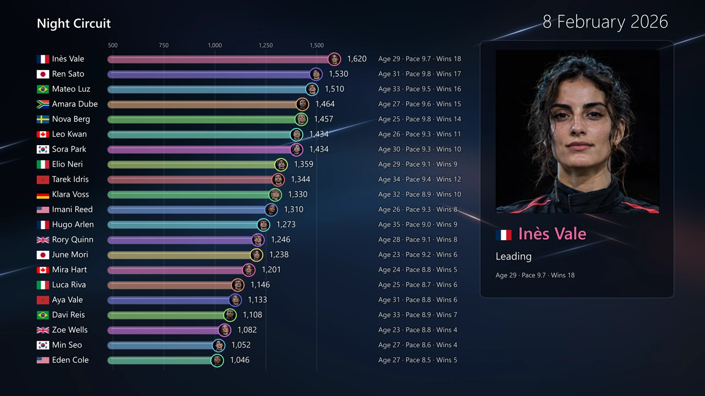

# glassybarrace



```sh
python barchartrace.py demo.csv race.mov
```

Requires matplotlib and FFmpeg. In the first CSV column, use YYYY-MM-DD or YYYY for days in first place. Export ProRes 4444 MOV, WebM, WebP, or PNG frames.
